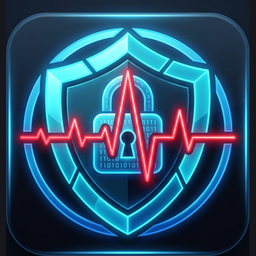
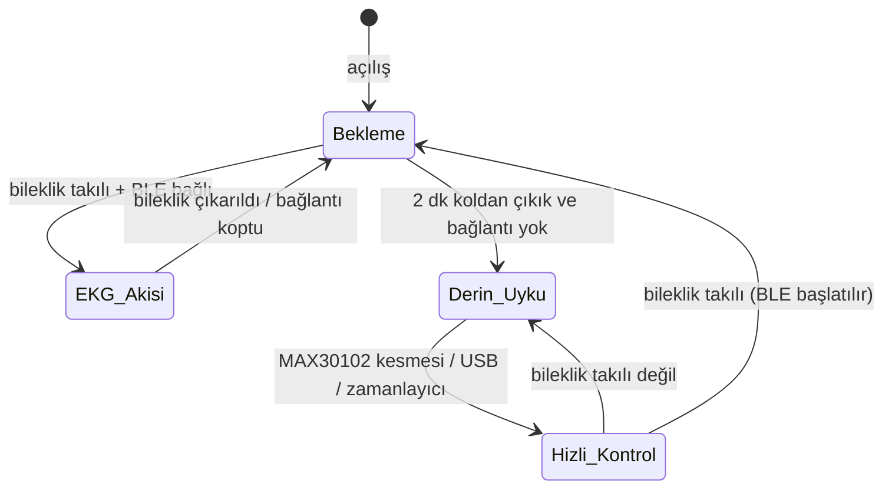

# 🫀 Ritim-EL — ESP32 Biyometrik Bileklik Firmware'i

<div align="center">


<br/>



### **"Kalp Ritminiz, Parolanızdır."**
*TÜBİTAK 2209-A Üniversite Öğrencileri Araştırma Projeleri Destekleme Programı kapsamında hazırlanmıştır (başvuru aşamasında).*

</div>

---

## 📌 Proje Hakkında

**Ritim-EL**, kullanıcıyı kalbinin elektriksel aktivitesinden (**EKG**) tanıyan biyometrik bir bilgisayar kilidi ve kiosk güvenlik sistemidir. Kullanıcı bilekliği taktığında EKG sinyali bileklikten Bluetooth Low Energy (BLE) ile bilgisayara gönderilir; bilgisayardaki uygulama sinyalin kayıtlı kişiye ait olup olmadığına karar verir.

Bu depo, sistemin **bileklik tarafını**, yani ESP32 üzerinde çalışan firmware'i içerir:

* AD8232 ile EKG ölçümü, 200 Hz örnekleme ve cihaz üzerinde sayısal filtreleme
* MAX30102 ile **canlılık** (bileklik gerçekten kolda mı?), nabız ve SpO2 ölçümü
* Cihaza özel anahtarla **şifreli ve kimliği doğrulanmış** BLE veri akışı
* Pil izleme ve **derin uyku** ile güç yönetimi

> [!NOTE]
> Bu açık depo yalnızca **ESP32 firmware** katmanını içerir. EKG tanıma modeli (PTB-XL ile eğitilen, ArcFace kayıplı 1B CNN gömme modeli), Windows kilit ekranı / kiosk uygulaması ve test altyapısı özel depoda tutulmaktadır.

---

## ✨ Öne Çıkan Özellikler

| Alan | Uygulama |
|---|---|
| **Kararlı örnekleme** | `loop()` FreeRTOS `xTaskDelayUntil` ile tik saatine kilitli; 200 Hz kaymaz, işlemci örnekler arasında uyur. |
| **Sinyal işleme** | 0,5 Hz yüksek geçiren + 50 Hz notch + 40 Hz alçak geçiren (2. derece IIR, katsayılar `scipy` ile üretildi), uyarlamalı eşikli R tepesi algılama. |
| **BLE parazit filtresi** | Telsiz her bağlantı olayında EKG'ye parazit karıştırır. Firmware bağlantı aralığını öğrenir ve EKG bandına düşen harmoniklere otomatik notch filtre uygular. |
| **Canlılık** | MAX30102 kızılötesi yansıması eşiğin altına inerse (bileklik çıkarıldı) EKG akışı durur. |
| **Güvenlik** | USB ile eşleştirme, cihaza özel 128 bit anahtar, AES-128-CTR + HMAC-SHA256, oturum nonce'u ve NVS'te kalıcı paket sayacı (replay koruması). |
| **Güç yönetimi** | 80 MHz işlemci, bağlantı yokken AD8232 kapalı, uyarlamalı reklam aralığı, koldan çıkınca derin uyku ve MAX30102 yakınlık kesmesiyle uyanma. |
| **Pil** | Standart BLE Pil Servisi (`0x180F`): seviye ve şarj durumu. |

---

## ⚡ Donanım Mimarisi

```
  ┌────────────────────┐   analog    ┌──────────────────┐
  │ AD8232 EKG ön      ├────────────►│ ADS1115 16-bit   │
  │ yükselteci         │             │ ADC (A0)         │
  └─────────▲──────────┘             └────────┬─────────┘
            │ SDN (güç)                       │ I2C
            │                                 │ (SDA 21 / SCL 22)
  ┌─────────┴─────────────────────────────────▼─────────┐
  │              ESP32-WROOM-32 (80 MHz)                │
  │  200 Hz örnekleme · IIR filtreler · R tepesi        │
  │  AES-128-CTR + HMAC-SHA256 · BLE GATT sunucusu      │
  └─────────▲──────────────────────────▲──────────┬─────┘
            │ I2C + INT (uyandırma)    │ VBAT/USB │ BLE bildirimleri
  ┌─────────┴──────────┐   ┌───────────┴──────┐   ▼
  │ MAX30102 PPG       │   │ Li-Po pil + şarj │  [ Windows uygulaması ]
  │ canlılık/nabız/SpO2│   │ devresi          │
  └────────────────────┘   └──────────────────┘
```

### 🔌 Pin Bağlantıları

| Bileşen | Sinyal | ESP32 | Açıklama |
|---|---|---|---|
| ADS1115 + MAX30102 | SDA / SCL | **GPIO 21 / 22** | Ortak I2C hattı (100 kHz) |
| AD8232 | OUTPUT | **ADS1115 A0** | EKG sinyali (16 bit). İsteğe bağlı: doğrudan GPIO 34 |
| AD8232 | SDN | **GPIO 33** | Güç kontrolü (LOW = kapalı) |
| MAX30102 | INT | **GPIO 35** | Yakınlık kesmesi, derin uykudan uyandırma |
| Pil | VBAT / 2 | **GPIO 36** | 100k/100k bölücü ile pil gerilimi |
| USB | USB_DET | **GPIO 25** | Şarj kablosu takılı mı |
| LED | — | **GPIO 2** | Her kalp atımında yanıp söner |

Pinler ve özellikler `ritim_el_v2_ble.ino` dosyasının başındaki **DONANIM AYARLARI** bölümünden değiştirilebilir. Kullanılmayan pinler `-1` yapılarak devre dışı bırakılır (ör. breadboard prototipi).

---

## 🔄 Çalışma Akışı



* **Bekleme:** BLE reklamı yapılır (ilk 30 sn hızlı, sonra ~1 sn aralıkla); AD8232 kapalıdır.
* **EKG akışı:** AD8232 açılır, çıkış 500 ms oturduktan sonra 10'arlı örnekler paketlenip saniyede 20 bildirimle gönderilir (20 × 10 = 200 örnek/sn).
* **Derin uyku:** MAX30102 düşük güçlü yakınlık modunda bekler; deri algılanınca ESP32'yi uyandırır. Uyanışta BLE başlatılmadan ~30 ms'lik bir kontrol yapılır, yersiz uyanmada tekrar uyunur.

---

## 📡 BLE Protokolü

**Servis:** `4fafc201-1fb5-459e-8fcc-c5c9c331914b`

| Karakteristik | UUID (son kısım) | Özellik | İçerik |
|---|---|---|---|
| EKG | `...26a8` | notify | 32 baytlık şifreli paket (aşağıda) |
| Nabız | `...26a9` | read, notify | 1 bayt, BPM |
| SpO2 | `...26aa` | read, notify | 1 bayt, % (0 = ölçülüyor) |
| Alarm / kontrol | `...26ab` | read, write, notify | Metin komutları (aşağıda) |
| Pil seviyesi | `0x2A19` | read, notify | 1 bayt, % (standart Pil Servisi `0x180F`) |
| Pil güç durumu | `0x2A1A` | read, notify | 1 bayt, şarj / deşarj bitleri |

**EKG paketi (eşleştirilmiş bileklik, 32 bayt):**

| Bayt | İçerik |
|---|---|
| `0–3` | Paket sayacı (açık, little-endian) |
| `4–23` | 10 × int16 EKG örneği, **AES-128-CTR** ile şifreli |
| `24–31` | **HMAC-SHA256** etiketinin ilk 8 baytı (nonce + bayt 0–23 üzerinden) |

**Kontrol komutları** (alarm karakteristiğine yazılır):

| Komut | Görev |
|---|---|
| `NONCE:<16 hex>` | Oturum nonce'u; PC her bağlantıda yeni bir değer yazar |
| `TIME:HH:MM:SS` | Bileklik saatini eşitler |
| `HH:MM[:V[:E]]` | Alarm kurar (V: titreşim, E: açık/kapalı) |
| `RING` / `STOP` | Titreşimi başlatır / durdurur |

---

## 🔐 Güvenlik Modeli

1. **Eşleştirme yalnızca USB kablosuyla yapılır.** PC uygulaması rastgele 128 bit bir anahtar üretip seri porttan gönderir (`RITIMEL:PAIR:<hex>`); anahtar ESP32'nin NVS belleğinde saklanır. Kablosuz eşleştirme olmadığı için bir saldırganın cihaza fiziksel erişimi gerekir.
2. **Anahtar ayrımı:** Şifreleme (`K_enc`), mesaj doğrulama (`K_mac`) ve anahtar kimliği, cihaz anahtarından HMAC ile ayrı ayrı türetilir. Anahtar kimliği eşleştirmeyi doğrulamaya yarar, anahtarı açığa çıkarmaz.
3. **Gizlilik ve bütünlük:** EKG örnekleri AES-128-CTR ile şifrelenir; her pakete HMAC etiketi eklenir. Değiştirilmiş ya da sahte paketler PC'de reddedilir.
4. **Replay koruması:** Her bağlantıda PC yeni bir nonce yazar ve etiket bu nonce'u kapsar; kaydedilip başka oturumda oynatılan paketler doğrulanamaz. Paket sayacı NVS'te tutulur ve yeniden başlatmada geriye gitmez.
5. **Canlılık:** Bileklik kolda değilse EKG hiç gönderilmez; MAX30102 bulunamazsa da EKG akışı başlatılmaz.

### Bilinen sınırlamalar ve planlanan iyileştirmeler

* **Geliştirme modu:** Eşleştirilmemiş bileklik, geliştirme kolaylığı için tüm cihazlarda ortak olan bir anahtarla (AES-128-CBC, sabit IV) veri gönderebilir. Bu anahtar gizli sayılmaz; PC uygulaması eşleştirilmemiş bilekliği varsayılan olarak kilit ekranında kabul etmez. Ürün derlemesinde `ALLOW_UNPAIRED_ECG 0` yapılarak bu mod tamamen kapatılır. Anahtar depoda tutulmaz (`secrets.h`).
* **Flash koruması:** Cihaz anahtarı NVS'te şifresiz durur. Üretim için ESP32 **Flash Encryption**, **Secure Boot** ve NVS şifreleme planlanmaktadır.
* **SpO2:** Değer referans bir oksimetreyle kalibre edilmemiştir; yalnızca gösterge amaçlıdır, tıbbi amaçla kullanılamaz.
* **Yakınlık modu:** MAX30102 veri sayfasında yakınlık modu belgelenmemiştir (MAX30101/30105'te vardır). Kesme gelmezse firmware bunu algılar ve zamanlayıcıyla yoklamaya geçer.

---

## 🚀 Kurulum ve Derleme

### 1. Gereksinimler
* [Arduino IDE 2.x](https://www.arduino.cc/en/software) ya da `arduino-cli`
* **ESP32 Arduino Core 3.x** (3.3.x ile test edildi). Ek kart yöneticisi adresi:
  ```
  https://espressif.github.io/arduino-esp32/package_esp32_index.json
  ```
* Kart: **ESP32 Dev Module**
* Kütüphaneler (Kütüphane Yöneticisi'nden):
  * `Adafruit ADS1X15` (2.6.x)
  * `SparkFun MAX3010x Pulse and Proximity Sensor Library` (1.1.x)
  * BLE kütüphanesi ESP32 core ile birlikte gelir.

### 2. Geliştirme anahtarını ayarlayın
```bash
cd firmware/ritim_el_v2_ble
cp secrets_example.h secrets.h
```
`secrets.h` içindeki iki değeri PC uygulamanızdaki geliştirme anahtarıyla değiştirin (16'şar karakter). Bu dosya `.gitignore`'dadır.

### 3. Derleyin ve yükleyin
**Arduino IDE:** `firmware/ritim_el_v2_ble/ritim_el_v2_ble.ino` dosyasını açın, portu seçip **Yükle**'ye basın.

**arduino-cli:**
```bash
arduino-cli compile --fqbn esp32:esp32:esp32 firmware/ritim_el_v2_ble
arduino-cli upload  --fqbn esp32:esp32:esp32 -p COM3 firmware/ritim_el_v2_ble
```

### 4. Seri port komutları (115200 baud)

| Komut | Yanıt örneği |
|---|---|
| `RITIMEL:INFO` | `RITIMEL:INFO:fw=2.8:paired=1:kid=AB12CD34` |
| `RITIMEL:PAIR:<32 hex>` | `RITIMEL:PAIR:OK:AB12CD34` |
| `RITIMEL:UNPAIR` | `RITIMEL:UNPAIR:OK` |
| `RITIMEL:BAT` | `RITIMEL:BAT:mv=3950:pct=72:usb=0` |
| `RITIMEL:SLEEP` | `RITIMEL:SLEEP:n=3:prox=2:false=0:miss=0:mode=prox` |

---

## 🧪 Test ve Doğrulama

* EKG ölçümü, filtreler ve BLE akışı **breadboard prototipinde** gerçek sensörlerle doğrulandı.
* Firmware, ESP32 donanım katmanının (I2C sensörler, BLE, NVS, derin uyku, GPIO) taklit edildiği bir **PC simülatöründe** aynı kaynak koduyla derlenip **35 otomatik senaryoda** test edilir: paket şifreleme ve doğrulama, replay koruması, 200 Hz zamanlama, bileklik takma/çıkarma, derin uyku ve uyanma, pil servisi. Simülatör ve PC tarafı testler özel depodadır.
* v2.7–v2.8 güç yönetimi özellikleri (pil ölçümü, derin uyku) şarjlı bileklik kartında saha testi aşamasındadır.

---

## 📂 Depo Yapısı

```
firmware/ritim_el_v2_ble/
├── ritim_el_v2_ble.ino     # firmware kaynak kodu
└── secrets_example.h       # geliştirme anahtarı şablonu (secrets.h olarak kopyalanır)
CHANGELOG.md                # sürüm geçmişi
```

---

## 👥 Geliştiriciler

Bu proje, TÜBİTAK 2209-A kapsamında hazırlanan bir bitirme projesi olarak **iki kişilik bir ekip** tarafından geliştirilmiştir.

| İsim | Bölüm / Rol | GitHub | LinkedIn | İletişim / E-Posta |
|---|---|---|---|---|
| **Hüseyin Konak** | Bilgisayar Mühendisliği Lisans Öğrencisi · Donanım ve Uygulama Geliştirme | [@huseyin-konak](https://github.com/huseyin-konak) | [linkedin.com/in/huseyin-konak](https://www.linkedin.com/in/huseyin-konak/) | [huseyinkonak.dev@gmail.com](mailto:huseyinkonak.dev@gmail.com) |
| **Tolga Karateke** | Geliştirici | – | [Tolga Karateke](https://www.linkedin.com/in/tolga-karateke-8a849a297/) | [ttolgakarateke07900@gmail.com](mailto:ttolgakarateke07900@gmail.com) |

---

## 📜 Lisans

Bu proje **TÜBİTAK 2209-A** kapsamında hazırlanan bir araştırma projesidir; firmware katmanı [MIT Lisansı](LICENSE) ile açık kaynak olarak paylaşılmıştır.
